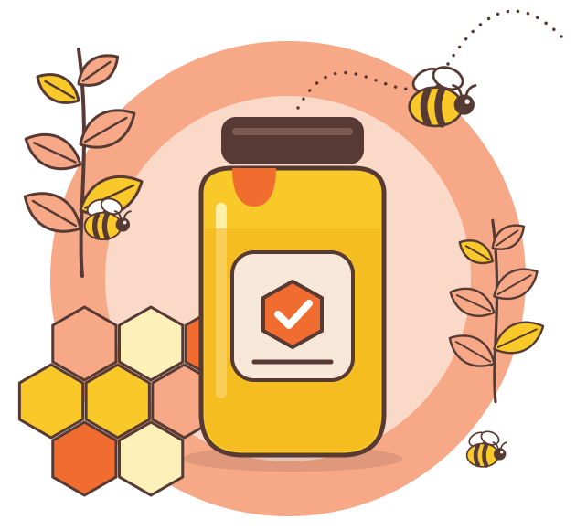

<div align="center">



# 🍯 HoneyChain

### Blockchain-Based Honey Traceability & Smart Beekeeping Management System

[](https://python.org)
[](https://djangoproject.com)
[](https://soliditylang.org)
[](https://hardhat.org)
[](https://web3py.readthedocs.io)
[](LICENSE)

> *"Every jar carries a proof, not just a promise."*

**HoneyChain** helps beekeepers manage their apiaries and honey production while giving customers a way to verify honey authenticity using blockchain technology and QR codes — from hive to jar.

[🚀 Quick Start](#-quick-start) · [📖 How It Works](#-how-it-works) · [🔗 Blockchain](#-blockchain-deep-dive) · [📸 Screenshots](#-screenshots) · [🧪 Demo Data](#-demo-accounts--data)

</div>

---

## 📋 Table of Contents

- [About the Project](#-about-the-project)
- [Features](#-features)
- [Technology Stack](#-technology-stack)
- [Project Structure](#-project-structure)
- [Quick Start](#-quick-start)
  - [Prerequisites](#prerequisites)
  - [1. Clone the Repository](#1-clone-the-repository)
  - [2. Set Up Python Environment](#2-set-up-python-environment)
  - [3. Configure Environment Variables](#3-configure-environment-variables)
  - [4. Set Up the Database](#4-set-up-the-database)
  - [5. Set Up the Blockchain (Hardhat)](#5-set-up-the-blockchain-hardhat)
  - [6. Deploy the Smart Contract](#6-deploy-the-smart-contract)
  - [7. Seed Demo Data](#7-seed-demo-data)
  - [8. Run the Development Server](#8-run-the-development-server)
- [How It Works](#-how-it-works)
- [Blockchain Deep Dive](#-blockchain-deep-dive)
- [Demo Accounts & Data](#-demo-accounts--data)
- [Running Tests](#-running-tests)
- [Contributing](#-contributing)
- [License](#-license)

---

## 🌟 About the Project

India is one of the world's largest honey producers, but honey adulteration is rampant — studies show that up to **77% of commercial honey may be adulterated** with sugar syrup or artificial flavours. Traditional paper-based records can be forged easily.

**HoneyChain solves this with blockchain:**

| Traditional System | HoneyChain |
|---|---|
| Paper records, easily forged | Digital records, cryptographically signed |
| No traceability for the customer | Full journey visible via QR code |
| Anyone can silently change records | Hash locked on blockchain forever |
| Trust based on brand name only | Trust verified mathematically |

---

## ✨ Features

### 🧑‍🌾 Module 1 — Beekeeper Management
- Secure user registration and login (Django auth)
- Beekeeper profile with phone and address
- **Apiary Management** — Add, view, edit, delete farm locations
- **Bee Colony Management** — Track colony type, health status, establishment date
- Dashboard with live stats: total apiaries, colonies, batches, verified batches

### 🍯 Module 2 — Honey Batch Management
- Auto-generated unique batch IDs: `HC-2026-A3F9C2`
- Honey source tracking: Mustard, Wildflower, Acacia, Eucalyptus, Litchi, Jamun, Multifloral
- 4-stage lifecycle: `Harvested` → `Processing` → `Packaged` → `Available`
- **Immutability lock** — once registered on blockchain, core fields are protected from silent editing

### 🔗 Module 3 — Blockchain Verification
- **SHA-256 cryptographic hashing** of batch data (deterministic, tamper-evident)
- **Solidity Smart Contract** (`HoneyChain.sol`) deployed on local Hardhat Ethereum node
- **Web3.py integration** — Django signs and broadcasts transactions
- Stores transaction hash + block number for each batch
- Real-time verification: compares current hash with the on-chain hash
- **Tamper detection** — any data change produces a different hash → fraud detected

### 📱 Module 4 — Customer Traceability
- **QR code generation** for every batch (using honey brand colours)
- **Public verification page** — no account needed
- Customers see: beekeeper name, apiary, honey source, harvest date, quantity, status
- Blockchain verification badge: ✅ Verified / ❌ Verification Failed / ⏳ Not Registered

---

## 🛠️ Technology Stack

| Layer | Technology | Version |
|---|---|---|
| **Language** | Python | 3.10+ |
| **Backend Framework** | Django | 6.1 |
| **Database** | SQLite | (default Django ORM) |
| **Frontend** | Django Templates + Tailwind CSS | CDN |
| **Smart Contract Language** | Solidity | ^0.8.19 |
| **Local Blockchain** | Hardhat (Ethereum simulator) | ^2.22 |
| **Blockchain Client** | Web3.py | 8.0.0 |
| **Hashing** | Python `hashlib` SHA-256 | stdlib |
| **QR Codes** | Python `qrcode` + `Pillow` | 8.2 / 13.0 |
| **Environment** | python-dotenv | 1.2.4 |

### Design System
| Property | Value |
|---|---|
| Fonts | Fraunces (headings) + Nunito (body) |
| Peach | `#F8A887` |
| Cream | `#F8EBD9` |
| Honey Orange | `#F16C2F` |
| Cocoa Brown | `#573A34` |
| Gold | `#FBC928` |

---

## 📁 Project Structure

```
HoneyChain/
│
├── manage.py                   # Django entry point
├── requirements.txt            # Python dependencies
├── README.md                   # This file
├── .env.example                # Environment variable template
├── .gitignore
│
├── config/                     # Django project configuration
│   ├── settings.py
│   ├── urls.py
│   ├── views.py                # Home & About pages
│   └── wsgi.py
│
├── accounts/                   # Beekeeper authentication & profiles
│   ├── models.py               # BeekeeperProfile
│   ├── views.py                # Register, login, logout, dashboard
│   ├── forms.py
│   └── templates/accounts/
│
├── apiaries/                   # Apiary CRUD management
│   ├── models.py               # Apiary model
│   ├── views.py
│   └── templates/apiaries/
│
├── colonies/                   # Bee colony management
│   ├── models.py               # BeeColony model
│   ├── views.py
│   └── templates/colonies/
│
├── honey/                      # Honey batch management
│   ├── models.py               # HoneyBatch + BlockchainRecord
│   ├── views.py                # CRUD + blockchain register/verify
│   ├── management/commands/
│   │   └── seed_data.py        # Indian demo data seeder
│   └── templates/honey/
│
├── traceability/               # Public customer verification portal
│   ├── views.py                # Public verify view (no login needed)
│   └── templates/traceability/
│
├── blockchain/                 # Django ↔ Blockchain integration layer
│   ├── contract.py             # Web3 connection + contract loader
│   ├── services.py             # register_batch / verify_batch
│   ├── utils.py                # SHA-256 hashing + QR code generation
│   └── verification.py
│
├── smart_contract/             # Ethereum smart contract (Hardhat)
│   ├── contracts/
│   │   └── HoneyChain.sol      # Solidity smart contract
│   ├── scripts/
│   │   └── deploy.js           # Deployment script
│   ├── test/
│   │   └── HoneyChain.test.js  # 9 smart contract tests
│   ├── hardhat.config.js
│   └── package.json
│
├── templates/                  # Global templates
│   ├── base.html               # Base layout
│   ├── home.html
│   ├── about.html
│   ├── dashboard.html
│   └── includes/
│       ├── navbar.html
│       ├── sidebar.html
│       └── footer.html
│
└── static/                     # Static assets
    ├── css/
    ├── js/
    └── images/                 # Bee, honeycomb, hero illustrations
```

---

## 🚀 Quick Start

### Prerequisites

Make sure the following are installed on your machine:

| Tool | Version | Download |
|---|---|---|
| **Python** | 3.10+ | [python.org](https://python.org) |
| **Node.js** | 18+ | [nodejs.org](https://nodejs.org) |
| **npm** | 8+ | (comes with Node.js) |
| **Git** | any | [git-scm.com](https://git-scm.com) |

---

### 1. Clone the Repository

```bash
git clone https://github.com/nishantkumar35/HoneyChain.git
cd HoneyChain
```

---

### 2. Set Up Python Environment

**Create and activate a virtual environment (recommended):**

```bash
# Windows
python -m venv venv
venv\Scripts\activate

# macOS / Linux
python3 -m venv venv
source venv/bin/activate
```

**Install Python dependencies:**

```bash
pip install -r requirements.txt
```

> **Note:** `web3` is required for blockchain features. If you skip it, the app still works for batch management but blockchain registration will be disabled.
> To enable: `pip install web3==8.0.0`

---

### 3. Configure Environment Variables

Copy the example environment file and fill in your values:

```bash
cp .env.example .env
```

Open `.env` and set the following:

```ini
# Django
SECRET_KEY=your-secret-key-here
DEBUG=True
ALLOWED_HOSTS=127.0.0.1,localhost

# Blockchain (fill after Step 6 — Deploy Smart Contract)
BLOCKCHAIN_NODE_URL=http://127.0.0.1:8545
CONTRACT_ADDRESS=                        # ← Paste contract address here after deploy
DEPLOYER_PRIVATE_KEY=                    # ← Paste Hardhat Account #0 private key here

# App
SITE_BASE_URL=http://127.0.0.1:8000
```

> ⚠️ **Never commit your `.env` file.** It is already in `.gitignore`.

---

### 4. Set Up the Database

Run Django migrations to create the SQLite database:

```bash
python manage.py makemigrations
python manage.py migrate
```

Create a Django superuser (for admin panel access):

```bash
python manage.py createsuperuser
```

---

### 5. Set Up the Blockchain (Hardhat)

> **This step requires Node.js.**  
> Open a **new terminal window** and keep it running throughout development.

```bash
# Navigate to smart contract directory
cd smart_contract

# Install Hardhat and dependencies
npm install

# (Optional) Run smart contract tests — should show 9 passing
npx hardhat test

# Start the local Hardhat blockchain node
npx hardhat node
```

You will see output like:
```
Started HTTP and WebSocket JSON-RPC server at http://127.0.0.1:8545/

Accounts
========
Account #0: 0xf39Fd6e51aad88F6F4ce6aB8827279cffFb92266 (10000 ETH)
Private Key: 0xac0974bec39a17e36ba4a6b4d238ff944bacb478cbed5efcae784d7bf4f2ff80
...
```

> **Keep this terminal running.** The blockchain node must be active for registration and verification.

---

### 6. Deploy the Smart Contract

Open a **second terminal** (while the Hardhat node runs in the first):

```bash
cd smart_contract
npx hardhat run scripts/deploy.js --network localhost
```

You will see:
```
🍯 Deploying HoneyChain smart contract...

✅ HoneyChain deployed successfully!
━━━━━━━━━━━━━━━━━━━━━━━━━━━━━━━━━━━━━
   Contract Address : 0x5FbDB2315678afecb367f032d93F642f64180aa3
   Network          : localhost
━━━━━━━━━━━━━━━━━━━━━━━━━━━━━━━━━━━━━
```

**Copy the contract address into your `.env`:**

```ini
CONTRACT_ADDRESS=0x5FbDB2315678afecb367f032d93F642f64180aa3
DEPLOYER_PRIVATE_KEY=0xac0974bec39a17e36ba4a6b4d238ff944bacb478cbed5efcae784d7bf4f2ff80
```

> The deployer private key is Hardhat's default Account #0 key — it is public and safe **only** for local development. Never use it in production.

---

### 7. Seed Demo Data

Populate the database with realistic Indian beekeeping demo data:

```bash
# Go back to the project root
cd ..   # (or cd e:\DJANGO\HoneyChain on Windows)

python manage.py seed_data
```

This creates:
- 3 beekeepers (Indian farmers across HP, Punjab, Uttarakhand)
- 5 apiaries with descriptions
- 8 bee colonies
- 5 honey batches (3 verified on-chain, 2 pending)

---

### 8. Run the Development Server

```bash
python manage.py runserver
```

Open your browser and go to:

| Page | URL |
|---|---|
| 🏠 Home | http://127.0.0.1:8000 |
| 📊 Dashboard | http://127.0.0.1:8000/dashboard/ |
| 🏭 Apiaries | http://127.0.0.1:8000/apiaries/ |
| 🍯 Honey Batches | http://127.0.0.1:8000/honey/ |
| 🔍 Verify (public) | http://127.0.0.1:8000/verify/HC-2026-IND001/ |
| ⚙️ Admin Panel | http://127.0.0.1:8000/admin/ |

---

## 🧠 How It Works

```
                     ┌─────────────────────────────────────────────┐
                     │             HONEYCHAIN FLOW                  │
                     └─────────────────────────────────────────────┘

  BEEKEEPER                   DJANGO + SQLITE                  BLOCKCHAIN
  ─────────                   ──────────────                   ──────────
  
  Registers apiary    ──▶  Saves to SQLite
  Adds colonies       ──▶  Saves to SQLite
  Creates honey batch ──▶  Saves to SQLite + Generates batch ID
                              │
                              │  Clicks "Register on Blockchain"
                              ▼
                         SHA-256(batch data)
                         → "9f3a8c21...e7b4"    ──────────────▶  registerBatch()
                                                                   stored on-chain ✅
                              │
                              │  QR code generated
                              ▼
  CUSTOMER                 Public URL
  ────────
  Scans QR code  ──▶  Traceability page
                           │
                           │  verifyBatch()
                           ▼
                    SHA-256(current data)  ──▶  Compare with on-chain hash
                    
                    Match?  ──▶  ✅ VERIFIED — data is authentic
                    No Match ──▶ ❌ TAMPERED — data was changed
```

---

## 🔗 Blockchain Deep Dive

### Smart Contract (`HoneyChain.sol`)

```solidity
contract HoneyChain {

    address public owner;
    mapping(string => bytes32) private batchHashes;
    mapping(string => bool)    private batchRegistered;

    // Store a batch hash — only the owner (deployer) can call this
    function registerBatch(string calldata batchId, bytes32 hashHex) external onlyOwner {
        require(!batchRegistered[batchId], "batch already registered");
        batchHashes[batchId]     = hashHex;
        batchRegistered[batchId] = true;
        emit BatchRegistered(batchId, hashHex, msg.sender, block.timestamp);
    }

    // Publicly verify — compare provided hash with stored hash
    function verifyBatch(string calldata batchId, bytes32 hashToVerify)
        external view returns (bool isVerified, bool isRegistered) {
        isRegistered = batchRegistered[batchId];
        isVerified   = isRegistered && (batchHashes[batchId] == hashToVerify);
    }
}
```

### SHA-256 Hash Generation (Python)

```python
def generate_batch_hash(batch) -> str:
    data_dict = {
        'batch_id':       batch.batch_id,
        'beekeeper_name': batch.beekeeper.get_full_name(),
        'apiary_name':    batch.apiary.name,
        'honey_source':   batch.honey_source,
        'harvest_date':   str(batch.harvest_date),
        'quantity':       str(batch.quantity),
        'location':       batch.location,
    }
    # sort_keys=True ensures the same JSON string regardless of insertion order
    json_string = json.dumps(data_dict, sort_keys=True, ensure_ascii=True)
    return hashlib.sha256(json_string.encode('utf-8')).hexdigest()
```

### Why It's Tamper-Proof

```
Registration:  quantity = "42.00 kg"  →  SHA-256: 9f3a8c21...e7b4   ← Stored on blockchain

Someone edits: quantity = "100.00 kg" →  SHA-256: 7b2e1f94...a3c8   ← DIFFERENT!

Verification:  9f3a8c21... ≠ 7b2e1f94...  →  ❌ VERIFICATION FAILED
```

---

## 🧪 Demo Accounts & Data

After running `python manage.py seed_data`:

### Login Credentials

| Username | Password | Name | Region |
|---|---|---|---|
| `ramesh_kumar` | `Password@123` | Ramesh Kumar | Kangra Valley, Himachal Pradesh |
| `gurpreet_singh` | `Password@123` | Gurpreet Singh | Amritsar, Punjab |
| `priya_sharma` | `Password@123` | Priya Sharma | Nainital, Uttarakhand |
| `admin` | `Admin@1234` | Admin | Django Admin Panel |

### Demo Honey Batches to Verify

| Batch ID | Source | Region | Status |
|---|---|---|---|
| `HC-2026-IND001` | 🌻 Mustard | Amritsar, Punjab | ✅ Verified |
| `HC-2026-IND002` | 🌸 Wildflower | Kangra Valley, HP | ✅ Verified |
| `HC-2026-IND003` | 🌼 Multifloral | Nainital, Uttarakhand | ✅ Verified |
| `HC-2026-IND004` | 🌿 Acacia | Kullu Valley, HP | ⏳ Processing |
| `HC-2026-IND005` | 🌲 Eucalyptus | Hoshiarpur, Punjab | ⏳ Harvested |

**Public verification URL format:**
```
http://127.0.0.1:8000/verify/<batch_id>/

Example: http://127.0.0.1:8000/verify/HC-2026-IND001/
```

---

## 🧪 Running Tests

### Django Tests

```bash
python manage.py test
```

Expected: **17 tests pass**

### Smart Contract Tests (Hardhat)

```bash
cd smart_contract
npx hardhat test
```

Expected: **9 tests pass**

```
  HoneyChain Smart Contract
    Deployment
      ✔ should set the deployer as owner
      ✔ should start with zero total batches
    registerBatch
      ✔ should register a new batch successfully
      ✔ should emit BatchRegistered event
      ✔ should NOT allow duplicate registration
      ✔ should NOT allow non-owner to register
    verifyBatch
      ✔ should verify a matching hash correctly
      ✔ should return false for wrong hash
      ✔ should return not-registered for unknown batch

  9 passing
```

---

## 🗂️ Database Models Summary

| Model | App | Purpose |
|---|---|---|
| `User` | Django built-in | Authentication |
| `BeekeeperProfile` | `accounts` | Extends User with phone & address |
| `Apiary` | `apiaries` | Beekeeper's farm location |
| `BeeColony` | `colonies` | Colonies within an apiary |
| `HoneyBatch` | `honey` | Honey production record |
| `BlockchainRecord` | `honey` | On-chain transaction details |

---

## 🔧 Troubleshooting

**❌ "Blockchain node is not reachable"**
> Start Hardhat node: `cd smart_contract && npx hardhat node`

**❌ "Smart contract not loaded"**
> Deploy contract: `cd smart_contract && npx hardhat run scripts/deploy.js --network localhost`
> Then copy the address to `CONTRACT_ADDRESS` in `.env`

**❌ Login fails with seeded accounts**
> Re-run `python manage.py seed_data` — it resets passwords to `Password@123`

**❌ QR code not generating**
> Ensure `Pillow` is installed: `pip install Pillow`

**❌ `web3` import error**
> Install web3: `pip install web3==8.0.0`

---

## 🤝 Contributing

1. Fork the repository
2. Create a feature branch: `git checkout -b feature/your-feature`
3. Commit your changes: `git commit -m "Add: your feature description"`
4. Push to the branch: `git push origin feature/your-feature`
5. Open a Pull Request

---

## 📄 License

This project is licensed under the **MIT License** — see the [LICENSE](LICENSE) file for details.

---

<div align="center">

**HoneyChain** — *Honest honey, traced from hive to jar.* 🍯

Made with ❤️ as a college project · Django + Ethereum · India 🇮🇳

</div>
